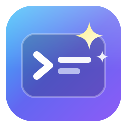
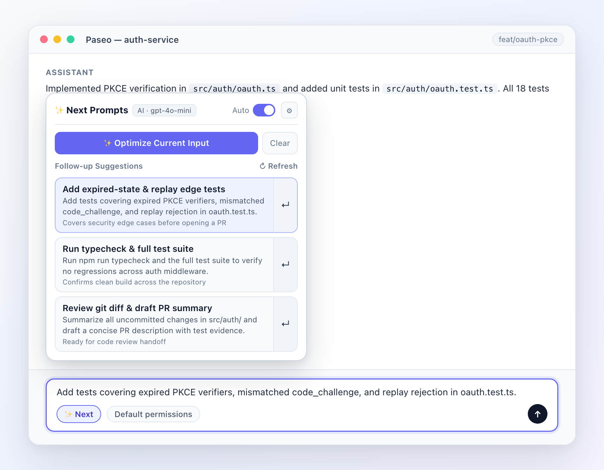
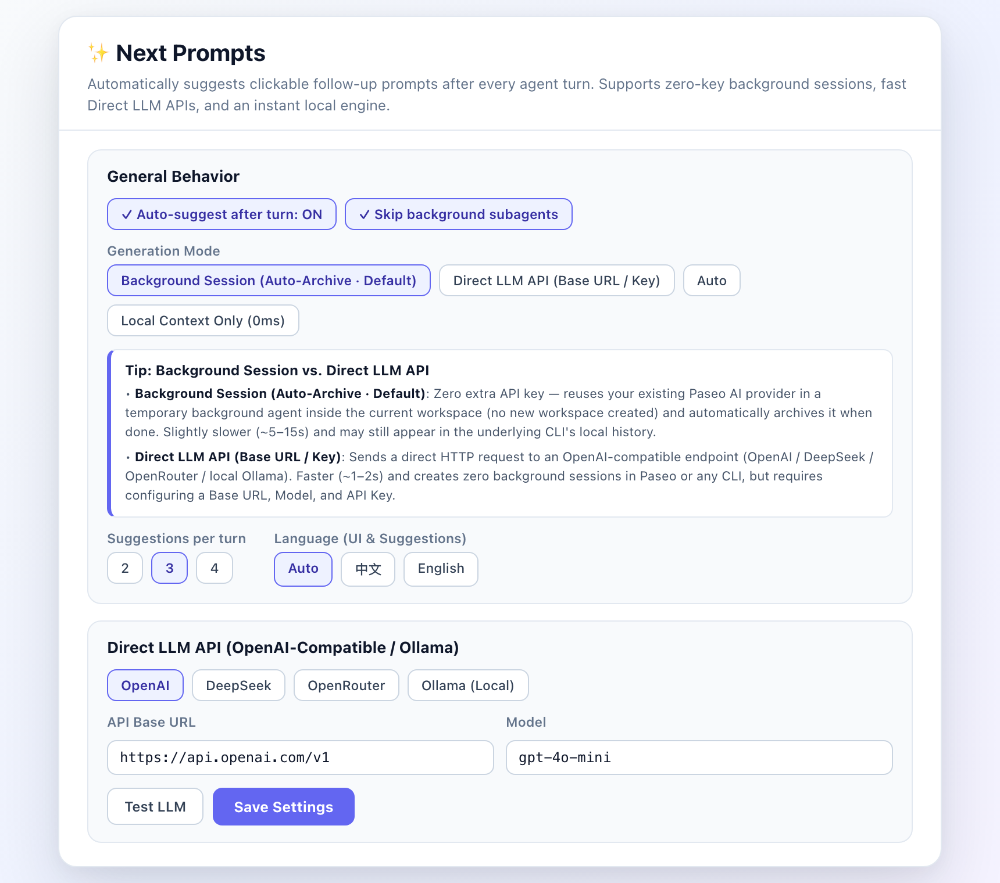

<p align="center">
  
</p>

<h1 align="center">paseo-next-prompts</h1>

<p align="center">
  <strong>AI-powered follow-up prompt suggestions &amp; one-click prompt optimizer for <a href="https://paseo.sh">Paseo</a>.</strong>
</p>

<p align="center">
  <a href="https://paseo.sh">= 0.16.0" /></a>
  <a href="./LICENSE"></a>
</p>

<p align="center">
  <strong>English</strong> | <a href="./README.zh-CN.md">简体中文</a>
</p>

**Next Prompts** automatically suggests actionable, context-aware follow-up prompts right after every completed agent turn — without touching `AGENTS.md` or replacing Paseo's native Markdown rendering. Click any suggestion to send immediately, load it into the composer to edit, or optimize your own rough draft in one click.

---

## 📸 Screenshots

### Composer Popover (`✨ Next`)
Auto-prefills the top follow-up suggestion when the agent finishes, with a per-session **Auto** toggle, one-click **Optimize Current Input**, and a quick **⚙** settings shortcut.

<p align="center">
  
</p>

### Settings & Generation Modes
Switch cleanly between **Background Session (Auto-Archive · Default)** and **Direct LLM API (Base URL / Key)**, configure OpenAI-compatible presets (OpenAI, DeepSeek, OpenRouter, local Ollama), and switch UI/output language (`Auto` / `中文` / `English`).

<p align="center">
  
</p>

---

## ✨ Features

- **Post-Turn Follow-Up Suggestions**: Triggers strictly after the agent finishes a turn (`idle`, no active turn, no pending permission requests, and a non-empty reply) by inspecting recent turns, tool outcomes, and `git status`.
- **Two Flexible AI Modes (+ 0ms Local Engine)**:
  - **Background Session (Auto-Archive · Default)**: Zero extra API key — reuses your existing Paseo AI provider (Codex, Cursor, Claude, OpenCode, Copilot, etc.) in a hidden background agent inside the **current workspace** (no new workspace created) and automatically archives it when done.
  - **Direct LLM API (Base URL / Key)**: Calls any OpenAI-compatible HTTP endpoint (OpenAI, DeepSeek, OpenRouter, or local Ollama) directly. Faster (~1–2s) with zero background sessions in Paseo or any underlying CLI.
  - **Local Context Engine (0ms)**: Instant offline fallback based on errors, proposed plans, modified files, and uncommitted diffs.
- **One-Click Prompt Optimizer**: Refine a rough draft directly inside the chat input box via the `✨ Next` popover, `/enhance <draft>`, or Command Center (`⌘K`), with instant **↩ Undo**.
- **Per-Session Auto Toggle**: Pause or resume automatic suggestions for the current session only via the toggle switch in the `✨ Next` header (persisted per agent, without affecting other sessions).
- **Full English / Chinese i18n**: Automatically follows Paseo's client locale (`Auto`) or switches live between English and Simplified Chinese for both the UI and generated prompts.

---

## ⚖️ Mode Comparison

| Mode | Setup | Speed | Background Session |
| :--- | :--- | :--- | :--- |
| **Background Session (Auto-Archive · Default)** | Zero extra API key (reuses Paseo provider) | ~5–15s (with 0ms local preview) | Hidden helper agent in current workspace, auto-archived on finish (may appear in CLI local history) |
| **Direct LLM API (Base URL / Key)** | API Base URL + Model + API Key (or local Ollama) | ~1–2s | None (pure HTTP request) |
| **Local Context Only** | None (offline) | 0ms | None |

---

## 📦 Installation

### From GitHub (Recommended)

```bash
paseo plugin add github:jawn-ha/paseo-next-prompts
```

### From a Local Clone

```bash
git clone https://github.com/jawn-ha/paseo-next-prompts.git
cd paseo-next-prompts
npm install
paseo plugin add .
```

---

## 🚀 Usage

| Entry Point | How to Trigger | Action |
| :--- | :--- | :--- |
| **Composer Pill (`✨ Next`)** | Click **✨ Next** below any agent chat input | Pick/send suggestions, optimize draft, toggle current session, or open settings (`⚙`) |
| **Slash Command `/next`** | Type `/next` in chat | Generate or refresh follow-up suggestions on demand |
| **Slash Command `/enhance`** | Type `/enhance <rough prompt>` | Rewrite a rough prompt and fill it into the chat box |
| **Command Center (`⌘K`)** | `Next Prompts: Settings` / `Toggle Auto-Suggest` / `Optimize Current Input` | Quick keyboard access from anywhere |

### Configuration File (Optional)

Settings are stored at `~/.paseo/next-prompts-config.json`. Stored API keys are bound to their configured API Base URL. In the Paseo daemon environment, `OPENAI_API_KEY` is only used with `https://api.openai.com`, and `PASEO_NEXT_PROMPTS_API_KEY` is only used when `PASEO_NEXT_PROMPTS_API_BASE_URL` matches the configured endpoint. Local endpoints (`localhost`, `127.0.0.1`, `[::1]`) work without an API key.

---

## 🛠️ Development

```bash
npm install
npm run typecheck
paseo plugin reload paseo-next-prompts
```

---

## 📄 License

[MIT](./LICENSE) © [jawn-ha](https://github.com/jawn-ha)
