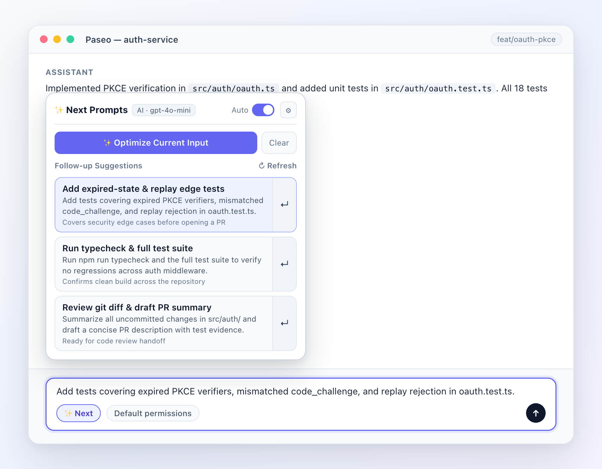
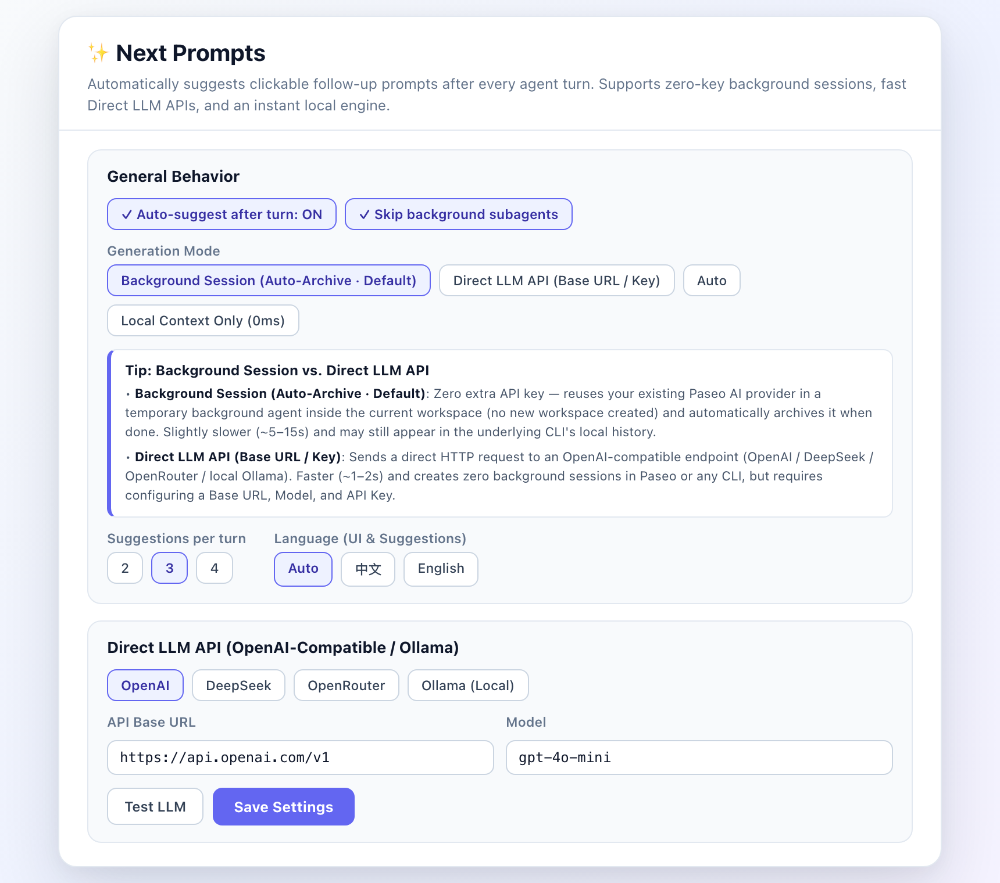

<p align="center">
  
</p>

<h1 align="center">paseo-next-prompts</h1>

<p align="center">
  <strong>为 <a href="https://paseo.sh">Paseo</a> 打造的 AI 下一步追问推荐与一键提示词优化插件。</strong>
</p>

<p align="center">
  <a href="https://paseo.sh">= 0.16.0" /></a>
  <a href="./LICENSE"></a>
</p>

<p align="center">
  <a href="./README.md">English</a> | <strong>简体中文</strong>
</p>

**Next Prompts** 在每轮 Agent 回复真正完成后自动推荐可点击的下一步追问提示词，无需修改 `AGENTS.md`，也不会替换 Paseo 原生 Markdown 渲染。点击建议可直接发送、填入输入框微调，或一键优化你正在输入的草稿提示词。

---

## 📸 界面预览

### 输入框气泡弹窗（`✨ Next`）
回合结束后自动将首选追问预填到输入框，顶部集成**当前会话自动推荐 Toggle 开关**与 **`⚙` 设置快捷入口**，支持一键优化当前输入、换一批与快捷发送。

<p align="center">
  
</p>

### 插件设置与生成模式
支持在**临时后台会话（自动归档 · 默认）**与**LLM API 直连模式（Base URL / Key）**间自由切换，内置 OpenAI / DeepSeek / OpenRouter / 本地 Ollama 预设，支持 `Auto / 中文 / English` 实时语言切换。

<p align="center">
  
</p>

---

## ✨ 核心特性

- **严格回合结束后生效**：仅当 Agent 真正处于 `idle`、无进行中 turn、无待审批权限且已输出回复内容后才触发分析与自动预填。
- **双 AI 模式 + 0ms 本地引擎**：
  - **临时后台会话（自动归档 · 默认）**：零额外 API Key，直接复用你已配置的 Paseo AI Provider（Codex / Cursor / Claude / OpenCode / Copilot 等），在**当前 Workspace 内**创建隐藏后台 Agent 并在完成后自动归档（不新建 Workspace）。
  - **LLM API 直连模式（Base URL / Key）**：直接通过 HTTP 调用任意 OpenAI 兼容接口（OpenAI / DeepSeek / OpenRouter / 本地 Ollama），响应更快（约 1–2 秒），且在 Paseo 与底层 CLI 中完全不产生任何后台会话。
  - **本地上下文引擎（0ms）**：离线秒出，基于本轮报错、计划确认、修改文件与未提交 diff 生成建议。
- **一键优化 Prompt**：在 `✨ Next` 弹窗、`/enhance <草稿>` 或 Command Center（`⌘K`）一键润色草稿，并支持 `↩ 撤销`。
- **当前会话独立开关**：在 `✨ Next` 弹窗右上角可单独暂停/开启当前会话的自动推荐，不影响其他会话。
- **完整中英文 i18n**：默认 `Auto` 自动跟随 Paseo 客户端语言，也可在设置页手动切换中文或英文并实时生效。

---

## ⚖️ 模式对比

| 模式 | 配置成本 | 响应速度 | 后台会话 |
| :--- | :--- | :--- | :--- |
| **临时后台会话（自动归档 · 默认）** | 零额外 Key（复用 Paseo Provider） | 约 5–15 秒（含 0ms 本地预览） | 在当前 Workspace 内运行并自动归档（不新建 Workspace，底层 CLI 本地历史可能留痕） |
| **LLM API 直连模式（Base URL / Key）** | 需填 Base URL + 模型 + API Key（或本地 Ollama） | 约 1–2 秒 | 无（纯 HTTP 请求） |
| **仅本地上下文引擎** | 无需配置（离线可用） | 0ms | 无 |

---

## 📦 安装方式

### 从 GitHub 安装（推荐）

```bash
paseo plugin add github:jawn-ha/paseo-next-prompts
```

### 本地克隆安装

```bash
git clone https://github.com/jawn-ha/paseo-next-prompts.git
cd paseo-next-prompts
npm install
paseo plugin add .
```

---

## 🚀 使用入口

| 入口 | 触发方式 | 功能 |
| :--- | :--- | :--- |
| **输入框气泡（`✨ Next`）** | 点击任意会话输入框下方 **✨ Next** | 选择/发送建议、一键优化输入、开关当前会话自动推荐、点击 `⚙` 打开设置 |
| **斜杠命令 `/next`** | 在聊天框输入 `/next` | 手动生成或刷新当前回合的追问建议 |
| **斜杠命令 `/enhance`** | 输入 `/enhance <你的草稿>` | 优化草稿提示词并回填到输入框 |
| **Command Center（`⌘K`）** | 搜索 `Next Prompts` | 快速打开设置、切换当前会话开关或优化输入 |

### 配置文件（可选）

设置保存在 `~/.paseo/next-prompts-config.json`，已保存的 API Key 与对应 API Base URL 严格绑定。在 Paseo daemon 环境变量中，`OPENAI_API_KEY` 仅用于 `https://api.openai.com`；`PASEO_NEXT_PROMPTS_API_KEY` 仅在 `PASEO_NEXT_PROMPTS_API_BASE_URL` 与当前配置端点一致时生效。本地接口（`localhost`、`127.0.0.1`、`[::1]`）无需 API Key 即可使用。

---

## 🛠️ 本地开发

```bash
npm install
npm run typecheck
paseo plugin reload paseo-next-prompts
```

---

## 📄 开源协议

[MIT](./LICENSE) © [jawn-ha](https://github.com/jawn-ha)
